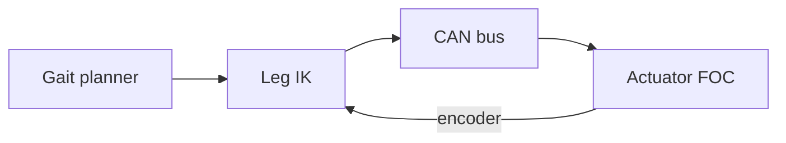

# hexapod-robot

Six-legged robot: leg actuator firmware, gait sims, and a bench winch rig.

- `fw/` — actuator firmware
- `docs/` — architecture notes
- `apps/` — agent-built control apps (MCP Apps), published to the hub canvas

## Control loop

